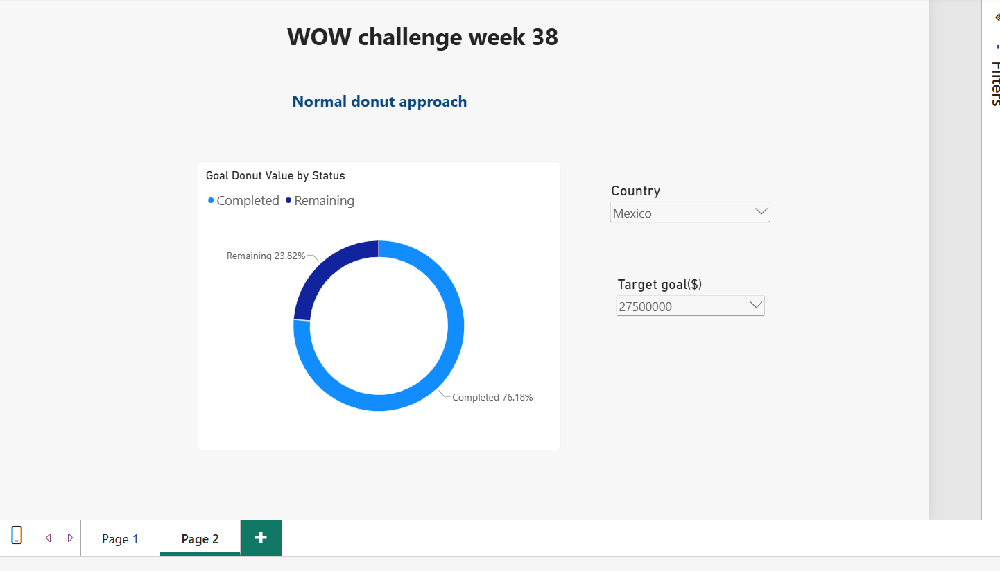
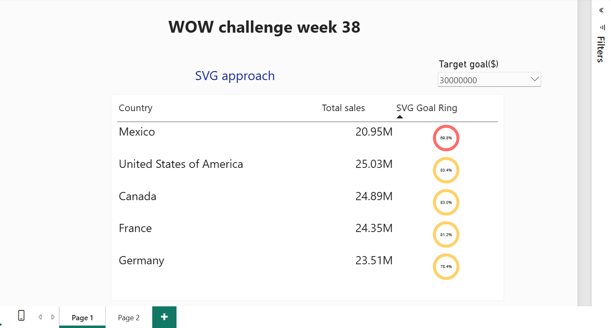

#  WOW Challenge – Week 38 | SVG Donut Charts

##  Challenge Overview

Explored two approaches to visualize **Sales Target Achievement** in Power BI:

1. **Normal Donut Chart** – Using built-in Power BI visuals.
2. **Dynamic SVG Donut** – Creating custom progress rings using DAX and SVG.

##  Business Questions

- How much sales revenue has each country generated?
- What percentage of its sales target has each country achieved?
- How much of the target is remaining?
- How does target achievement change when the target value changes?

---

##  Approach 1 – Normal Donut Chart

Created a dynamic target selection table using `GENERATESERIES()` and calculated completed and remaining target percentages.

### Key DAX Measures

**1. Total Sales**

```DAX
Total Sales =
SUM(financials[Sales])
```

**2. Goal Achievement Percentage**

```DAX
Goal Achievement % =
DIVIDE(
    [Total Sales],
    [Target Goal ($) Value],
    0
)
```

**3. Goal Completed**

```DAX
Goal Completed =
MIN(
    [Goal Achievement %],
    1
)
```

**4. Goal Remaining**

```DAX
Goal Remaining =
1 - [Goal Completed]
```

**5. Goal Donut Value**

```DAX
Goal Donut Value =
SWITCH(
    SELECTEDVALUE('Goal Status'[Status]),
    "Completed", [Goal Completed],
    "Remaining", [Goal Remaining]
)
```

###  Screenshot – Normal Donut Chart



---

##  Approach 2 – Dynamic SVG Donut

Recreated the progress ring using a DAX measure that generates SVG dynamically.

### SVG Concepts Used

- Circle circumference
- `stroke-dasharray`
- `stroke-dashoffset`
- `stroke-width`
- `stroke-linecap`
- SVG rotation using `transform`
- Dynamic colours using `SWITCH(TRUE())`
- SVG rendering through Image URL

### Dynamic Colour Logic

| Achievement | Colour | Meaning |
|---|---|---|
| ≥ 100% | 🟢 Green | Target achieved |
| ≥ 75% | 🟡 Amber | Approaching target |
| < 75% | 🔴 Red | Below target |

### Important Concept: Capped vs Actual Percentage

I used two percentage variables:

- **`Pct`** – Capped at 100% to control the ring.
- **`PctText`** – Displays the actual achievement percentage.

This ensures that even when achievement exceeds 100%, the ring remains complete while the actual percentage is displayed.

###  Screenshot – SVG Donut Chart



---

##  Key Learnings

- Created dynamic target selection using `GENERATESERIES()`.
- Practiced `SELECTEDVALUE()`, `DIVIDE()`, `MIN()`, and `SWITCH()`.
- Understood disconnected tables and filter context.
- Learned how circle circumference controls SVG progress rings.
- Explored dynamic SVG generation using DAX.
- Understood the difference between capped and actual percentages.
- Compared standard Power BI visuals with custom SVG visuals.

---

##  My Takeaway

The standard Donut Chart helped me validate the business calculations, while SVG gave me more flexibility to display multiple dynamic progress rings inside a table.

**DAX controls the business logic, SVG controls the visual design, and filter context makes the visuals interactive.**

---

##  Tools & Technologies

- Power BI Desktop
- DAX
- SVG
- Power BI Image URL
- GitHub

---

##  What I Learned

This challenge helped me understand how DAX calculations and SVG can work together to create dynamic visuals in Power BI.

My learning journey was:

Business Question
        ↓
Calculate Sales Achievement
        ↓
Create Dynamic Target Selection
        ↓
Validate Using Normal Donut Chart
        ↓
Understand Filter Context
        ↓
Calculate SVG Ring Geometry
        ↓
Generate Dynamic SVG Using DAX
        ↓
Display Multiple Progress Rings
        ↓
Improve Visual Communication


**Start with the business calculation, validate it with a standard visual, and then explore SVG when you need more design flexibility.**
