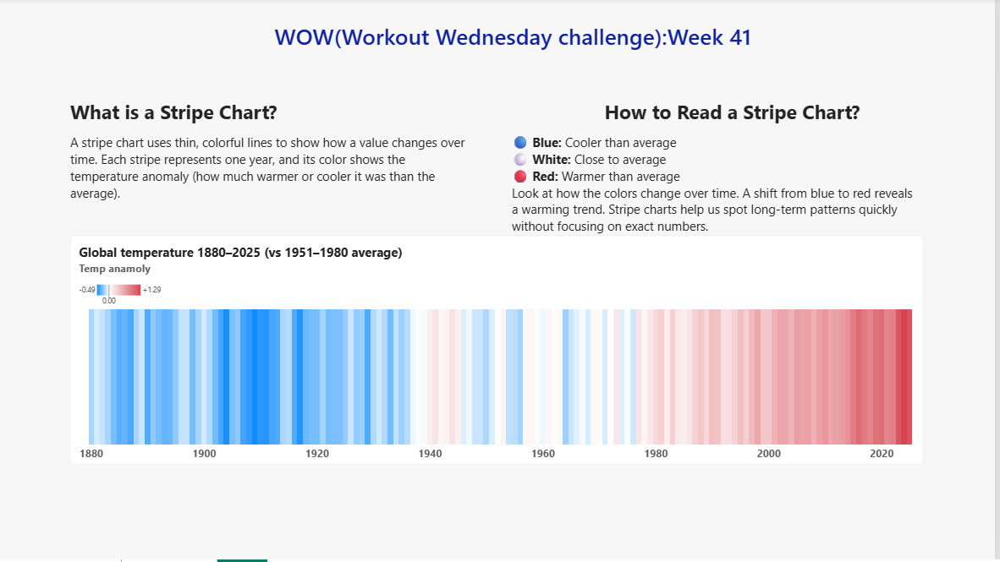

# WOW Challenge – Week 41: Stripe Chart

##  Challenge Overview

This challenge explores how to create a Stripe Chart
using the native column chart in Power BI.

The objective is to visualise global temperature
anomalies from 1880 to 2025 using colour variations.

##  Dataset

Global Temperature Dataset

- Source: Workout Wednesday
- Period: 1880–2025
- Reference Period: 1951–1980

##  My Approach

1. Explored and understood the dataset.
2. Created DAX measures for stripe height and temperature anomaly.
3. Built a native column chart.
4. Applied conditional formatting using a blue-white-red gradient.
5. Designed the report with explanations and insights.

##  Dashboard Preview



##  DAX Measures

### 1. Stripe Height

```dax
Stripe Height = 1

Temp Anomaly =
AVERAGE(GlobalTemp[Anomaly])
