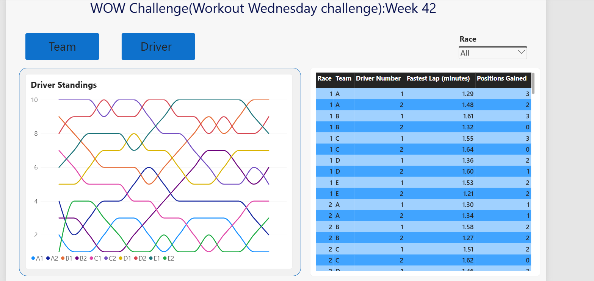

# WOW Challenge – Week 42: Overlay Information With Bookmarks

##  Challenge Overview

This challenge explores how to use **Bookmarks, Buttons, and the Selection Pane** in Power BI to create interactive report experiences.

The objective is to switch between Team Standings and Driver Standings using bookmarks, highlight the fastest lap for each race, and provide additional information through an overlay.

The challenge demonstrates how bookmarks can improve dashboard navigation and user experience without creating multiple report pages.

##  Dataset

Formula 1 Standings Dataset

- Source: Workout Wednesday
- Challenge: 2026 Week 42
- Challenge by: Vivien Lee
- Main focus: Team Standings, Driver Standings, Fastest Lap, and Race Results.

##  My Approach

1. Explored and understood the racing dataset.
2. Created a measure to identify and highlight the fastest lap for each race.
3. Built a table visual displaying race results.
4. Added a Race slicer to filter the results.
5. Created two bump charts:
   - Team Standings
   - Driver Standings
6. Positioned both charts in the same location.
7. Used the Selection Pane to control chart visibility.
8. Created Team View and Driver View bookmarks.
9. Connected buttons to bookmarks to switch between the two charts.
10. Tested bookmark interactions to ensure the Race slicer selection was preserved.

##  Dashboard Preview

##  DAX Measures

### 1. Fastest Lap Per Race

dax
Fastest Lap per Race =

VAR _CurrentRace =
    SELECTEDVALUE(Standings[Fastest Lap (minutes)])

VAR _FastestLapThisRace =
    CALCULATE(
        MIN(Standings[Fastest Lap (minutes)]),
        ALLEXCEPT(
            Standings,
            Standings[Race]
        )

    )

##  Visualisation Techniques

### 1. Team Standings Bump Chart

- Used a line chart to visualise team ranking movements across races.
- Each line represents a team.
- Shows how team positions change throughout the races.

### 2. Driver Standings Bump Chart

- Created a separate bump chart to visualise driver ranking movements.
- Each line represents an individual driver.
- Allows users to explore driver performance across races.

### 3. Fastest Lap Table

- Displayed Race, Team, Driver Number, Fastest Lap, and Positions Gained.
- Applied conditional formatting using a DAX measure.
- Highlighted the fastest lap for each race.

### 4. Race Slicer

- Added a slicer to filter race results.
- Allows users to explore different races interactively.
- Configured bookmarks to preserve slicer selections while switching between charts.

##  Bookmark Implementation

Used Power BI bookmarks to switch between two overlapping charts without creating separate report pages.

### 1. Team View Bookmark

- Displays the Team Standings chart.
- Hides the Driver Standings chart.

### 2. Driver View Bookmark

- Displays the Driver Standings chart.
- Hides the Team Standings chart.

### 3. Button Actions

Connected two buttons to their respective bookmarks:

- **Team Button:** Activates the Team View bookmark.
- **Driver Button:** Activates the Driver View bookmark.

### 4. Bookmark Settings

- **Display:** Enabled to capture visual visibility.
- **Data:** Disabled to avoid unintentionally resetting slicer selections.
- **Selected Visuals:** Used to control the visibility of the relevant chart objects.

##  Key Learnings

1. Learned how to use Power BI bookmarks to save and restore report states.
2. Understood how the Selection Pane controls visual visibility.
3. Learned how to position multiple charts in the same location and switch between them.
4. Explored how buttons and bookmark actions create interactive report navigation.
5. Understood the difference between Data and Display settings in bookmarks.
6. Learned how to preserve slicer selections while switching between different report views.
7. Used DAX measures with conditional formatting to highlight important information in a table.
8. Understood how bookmarks can improve dashboard navigation and user experience.
9. Learned the importance of updating bookmarks after changing visual visibility.
10. Improved troubleshooting skills by testing bookmark interactions and correcting visibility settings.

##  Potential Extensions

The challenge also introduces additional bookmark-based interactions that can be explored further:

- **Overall vs Focused View:** Create additional bookmarks to switch between different report layouts.
- **Information Overlay:** Use shapes, text boxes, and arrows to display instructions over the dashboard.
- **Info On / Info Off:** Create bookmarks to show and hide the information overlay.

##  Tools & Technologies

- Power BI Desktop
- DAX (Data Analysis Expressions)
- Native Line Chart
- Table Visual
- Slicer
- Bookmarks
- Selection Pane
- Buttons and Actions
- Conditional Formatting

## 🔗 Challenge Reference

[Workout Wednesday – 2026 Week 42: Overlay Information With Bookmarks](https://www.workout-wednesday.com/2026-week-42-power-bi-overlay-information-with-bookmarks/)

##  Acknowledgement

A big thank you to **Vivien Lee** for designing this interesting challenge and to the **Workout Wednesday team** for continuously encouraging the Power BI community to experiment with new visualisation techniques and interactive reporting features.

---

###  Learning Takeaway

Bookmarks are more than just navigation tools. By combining bookmarks, buttons, and the Selection Pane, we can create interactive dashboards that allow users to explore different perspectives without overwhelming them with too many visuals or report pages.
RETURN
    IF(
        _CurrentRace = _FastestLapThisRace,
        "#8D2E46",
        "#2D303A"
    )
